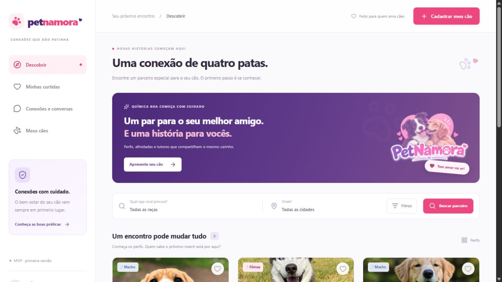

# Verificação do MVP

## PostgreSQL no Railway — 27/10/2026

- Criado o serviço `Postgres` (`22441e6a-f3de-4bd4-a75f-f9c87ccd8ea1`) no ambiente `production` do projeto próprio Pet Namora, com volume persistente `postgres-volume`. O serviço ficou online.
- Adicionada ao serviço `petnamora` a referência privada `DATABASE_URL=${{Postgres.DATABASE_URL}}`. Configurado `npm run db:migrate` como comando pré-deploy. Nenhuma credencial foi exposta nos arquivos locais nem foi utilizado banco de outro SaaS.
- O deploy `aa7a1ce6-aa2d-499d-894f-78a5de80ad97`, baseado na `main`, compilou e executou a migração `20261027150000_initial` no banco `railway`, schema `public`, host privado `postgres.railway.internal:5432`. Os logs confirmaram “All migrations have been successfully applied.” e a inicialização do Next.js com “Ready in 42ms”.
- A interface do banco exibiu as tabelas `_prisma_migrations`, `Dog`, `Like`, `Match`, `Message`, `Report`, `Session` e `User`. A consulta visual de `Dog` confirmou “This table is empty”. App e PostgreSQL ficaram online após a implantação.
- A migração local de remoção do campo `demo` ainda depende de publicar seu código na `main`; ela não foi aplicada isoladamente ao banco de produção para manter compatibilidade com a versão que está rodando. Nenhum seed foi executado, e nenhum dado local foi copiado para o banco de produção.
- A aplicação continua sem domínio público. A conclusão da publicação inclui as alterações locais, integração Cloudflare da `develop`, `JWT_SECRET`, `APP_URL`, `APP_HOST=0.0.0.0` e health check. O banco de produção está provisionado e conectado, sem significar que todo o fluxo público já foi homologado.

## Remoção da demonstração — 27/10/2026

- A migração `20261027200000_remove_demo_profiles` foi aplicada no banco local próprio, após backup em `.local/backups/`. Foram removidos seis perfis fictícios e a conta do antigo seed. O único perfil real e sua conta foram preservados; a comparação dos hashes dos registros antes e depois confirmou que não houve alterações nesses dados.
- O seed e sua execução no iniciador Windows foram removidos. O modelo, a API e os componentes deixaram de usar o campo `demo`; uma instalação nova começa sem cadastros fictícios.
- O formulário de cadastro não preenche idade, sexo, porte ou estado com valores presumidos. A busca sem resultados oferece uma mensagem e ação conforme haja filtros aplicados ou a comunidade ainda esteja vazia.
- `npm run test:migrations`: dois cenários passaram em schemas isolados com rollback. A limpeza preservou perfis, sessões, curtidas, matches, mensagens e denúncias reais; removeu as interações fictícias por cascata; preservou a conta do antigo seed quando havia um perfil real vinculado a ela.
- `npm run lint`, `npm run typecheck`, `npm run build` e `git diff --check` passaram. O health check, a página inicial e a busca responderam HTTP 200. A API retornou somente o perfil real, sem campo `demo`, IDs de exemplo ou fotos do Unsplash. Uma busca sem correspondência retornou uma lista vazia.
- No navegador, a tela mostrou somente o cadastro real. A busca sem correspondência exibiu “Nenhum cachorro encontrado”; limpar a busca restaurou o perfil real. O servidor de desenvolvimento foi reiniciado em `http://localhost:3003`.
- Esta alteração foi validada localmente. Não houve publicação nem migração do banco de produção nesta etapa. Os limites de lançamento descritos no README continuam pendentes.

## Histórico anterior à remoção

Executada em 27/10/2026 no banco próprio `petnamora`, porta 5437.

## História verificada

Dois tutores cadastram seus cães, encontram um parceiro, demonstram interesse mútuo e conversam; um terceiro tutor não pode acessar essa conversa.

| Fronteira | Resultado observado |
| --- | --- |
| Banco e aplicação | `/api/health`: HTTP 200, `status: ok` |
| Cadastro | Três tutores temporários criados, sem hash de senha no JSON público |
| Foto | Upload autenticado HTTP 201; leitura HTTP 200 com `image/png` |
| Perfil | Dois cães criados via API; edição por terceiro negada com HTTP 404 |
| Busca | Raça Golden, cidade Campinas e sexo fêmea retornaram o cão esperado; exemplos excluídos quando há perfis reais de outros tutores |
| Interesse | Primeira curtida não criou match; reciprocidade criou um; repetição não duplicou |
| Conversa | Mensagem gravada por um tutor e lida pelo outro |
| Autorização | Terceiro recebeu HTTP 404 na leitura e envio de mensagens; visitante anônimo recebeu HTTP 401 |
| Origem | Mutação com origem externa recebeu HTTP 403 |
| Denúncia | Bloqueou leitura da conversa para ambos os participantes com HTTP 403 |
| Logout | Reutilizar o cookie após sair retornou usuário nulo |
| Interface | Tela inicial inspecionada; abertura dos filtros, busca Golden com dois resultados e abertura/fechamento do diálogo de cadastro confirmadas no navegador |

Contas, cães, mensagens e foto criados por essa verificação foram removidos ao final. Permaneceram apenas os seis perfis explicitamente marcados como exemplos. Nenhuma conta real do usuário foi usada.

O servidor standalone também foi iniciado localmente com `npm run start`. A página inicial, o health check e a logo responderam HTTP 200; a tela final foi conferida no navegador nessa versão.

`npm run lint`, `npm run typecheck` e o build Next.js passaram. No Windows, pare o servidor antes de gerar novamente o Prisma Client: o processo em execução mantém a DLL aberta. Um build com o servidor ativo encontrou esse bloqueio; repetir após encerrar o servidor concluiu com sucesso.

O fluxo de autenticação, perfil e conversa foi exercitado pelas APIs; no navegador foram verificados a tela inicial, busca e diálogos, sem criação de conta pela interface. Não houve teste em dispositivo móvel físico, auditoria de segurança ou teste de carga. Veja os limites de lançamento no README.

## Integração Cloudflare Images — 27/10/2026

- TypeScript, ESLint e compilação de produção Next.js passaram; os assets standalone foram preparados. Como não houve mudança no schema, foi executado `next build` sem regenerar o Prisma Client que o servidor local mantém aberto.
- Testes com respostas simuladas da API Cloudflare confirmaram o envio multipart autenticado, bytes e MIME corretos, IDs `petnamora/<uuid>`, identificação do criador e retorno da URL da variante `public`.
- O schema dos perfis aceitou a URL da conta configurada e rejeitou outras contas, prefixos, variantes, HTTP, host adulterado, query strings e caminhos manipulados.
- Respostas de erro, timeout, JSON inválido e ausência da variante `public` retornaram erro sem gravar no disco. Credenciais ausentes e provedor desconhecido impediram o upload antes de qualquer requisição externa.
- No servidor de desenvolvimento, o fluxo real foi verificado por HTTP: cadastro temporário, upload autenticado, leitura pública dos mesmos bytes, criação do perfil e consulta da URL persistida no PostgreSQL próprio. Upload sem sessão, origem externa, assinatura de imagem inválida e arquivo acima de 5 MB foram rejeitados. A conta, perfil, sessão e arquivo de teste foram removidos.
- Após autorização do usuário, as três variáveis de conta/token/hash foram copiadas da configuração Cloudflare Images do Meu Site Perfeito para o serviço `petnamora` do projeto Railway próprio, junto de `PHOTO_STORAGE=cloudflare`. As quatro alterações foram aplicadas; nenhum segredo foi incluído no Git.
- Um upload real da logo pública foi feito pelo adaptador do Pet Namora. A URL da variante `public` respondeu HTTP 200 com conteúdo de imagem. Somente essa imagem temporária, identificada pelo UUID gerado no teste, foi removida ao final, com sucesso confirmado pela API Cloudflare.
- O teste real confirma as credenciais e a entrega pela CDN. O código da integração permanece na branch `develop`; o serviço Railway acompanha `main`, portanto a publicação dessa integração ainda depende de incorporar a mudança à `main` e completar a configuração de produção da aplicação.
